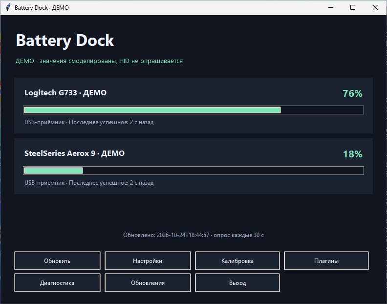
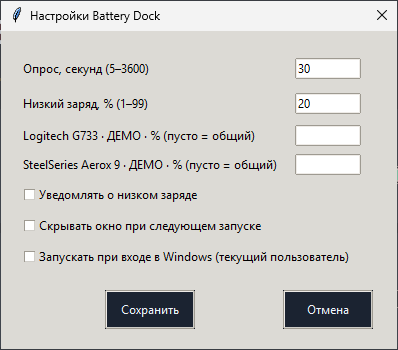

# Battery Dock

**Заряд беспроводных устройств — прямо в трее Windows.**

**Русский** · [English](README.en.md)

[](https://github.com/D1ssolve/battery-dock/actions/workflows/build-windows.yml)
[](LICENSE)


**[Скачать релиз](https://github.com/D1ssolve/battery-dock/releases) · [Что нового](CHANGELOG.md) · [Сообщить об ошибке](https://github.com/D1ssolve/battery-dock/issues/new/choose) · [Создать плагин](docs/PLUGINS.md)**

Battery Dock — независимое приложение с открытым исходным кодом для мониторинга
заряда Logitech G733 и SteelSeries Aerox 9 Wireless. У каждого устройства своя
иконка в трее; тёмное окно объединяет показания, калибровку и настройки.
Интерфейс — **на русском языке**.

> **0.4 — ранний прототип, а не стабильный продукт с подтверждённой совместимостью.**
> EXE не подписан. Процент G733 оценивается по напряжению. Пользователь подтвердил чтение
> Aerox 9 через приёмник в 0.2; точность по диапазону заряда и ревизиям ещё не проверена. Демонстрационные скриншоты и успешный CI не
> подтверждают работу реального оборудования. Не отключайте SmartScreen и антивирус.

## Возможности

- **Только иконки устройств:** заряд, состояние устройства/зарядки и меню без
  отдельной лишней иконки приложения. При недоступном трее окно остаётся доступным.
- **Управление:** обновление показаний, интервал опроса, предупреждения о низком
  заряде, пороги для отдельных устройств, добровольный автозапуск и один экземпляр.
- **Честные показания:** отсутствие данных не превращается в 0%, старые значения
  не выдаются за свежие. Калибровка G733 использует вручную введённые точки, не API G HUB.
- **Расширение:** локальные Python-плагины с явным подтверждением доверия,
  дочерними процессами и тайм-аутами. Это **не защитная песочница**.
- **Локальная работа:** без аккаунта и телеметрии. Диагностика сохраняется локально.
  Обновления проверяются только вручную; автоматической загрузки и установки нет.

## Скриншоты



*Окно приложения в DEMO-режиме: смоделированные значения, не измерения устройств.*



*Настройки русскоязычного интерфейса. Реальные снимки приложения на Windows CI.*

Такой же DEMO-режим можно открыть командой `python -m battery_dock --demo`.

## Скачать и запустить

1. Откройте [Releases](https://github.com/D1ssolve/battery-dock/releases), выберите
   опубликованную версию и скачайте `BatteryDock-<версия>-Windows-x64.zip` вместе
   с `.zip.sha256`. Версия в исходниках сама по себе не означает публикацию релиза.
2. Сравните SHA-256 архива с файлом контрольной суммы, затем распакуйте весь ZIP.
3. Запустите `BatteryDock.exe` обычным пользователем: Python и права администратора
   не нужны. EXE не подписан; если не можете установить доверие, изучите исходники.
4. Подключите оригинальный USB-приёмник и дождитесь опроса. Windows может скрыть
   значки в переполнении трея. Закрытие прячет окно только при наличии рабочей
   иконки; для завершения выберите **«Выход»**.

```powershell
Get-FileHash .\BatteryDock-0.4.0-Windows-x64.zip -Algorithm SHA256
Get-Content .\BatteryDock-0.4.0-Windows-x64.zip.sha256
```

Хеш подтверждает целостность относительно опубликованной суммы, но не личность
издателя. Сохраняйте исходники и лицензии при распространении. Если релиза ещё нет,
[успешные CI-сборки](https://github.com/D1ssolve/battery-dock/actions/workflows/build-windows.yml)
содержат артефакты `BatteryDock-Windows-x64-<номер>` со сроком хранения 30 дней;
может потребоваться вход в GitHub. Автоматический архив исходников GitHub не содержит EXE.

### Обновление переносимой версии

Перед заменой EXE или распаковкой новой версии выберите **«Выход»** в меню
устройства. Настройки и калибровка в `%APPDATA%\BatteryDock` сохраняются.
Лучше использовать прежнюю папку, чтобы путь включённого автозапуска не изменился.
Если перенести приложение, существующая запись Windows Run продолжит указывать
на старый путь: явно выключите и снова включите автозапуск в новой копии.
Обновление выполняется вручную; подписанного автоматического обновлятора нет.

## Устройства и ограничения

| Устройство | Подключение | Показания и степень проверки |
| --- | --- | --- |
| Logitech G733 | Оригинальный USB-приёмник, HID++ | Оценка по напряжению, опциональная локальная калибровка. Не точный процент производителя. |
| SteelSeries Aerox 9 Wireless | Оригинальный USB-приёмник 2,4 ГГц | Пользователь подтвердил чтение через приёмник в 0.2 (100%, без зарядки). Шаг протокола — 5%; проверка диапазона и прошивок продолжается. |
| Другие устройства | Локальный плагин-провайдер | Зависит от конкретного плагина; общей гарантии совместимости нет. |

Bluetooth Battery Service, произвольные приёмники и изменение прошивок не
реализованы. Ревизия и прошивка имеют значение. Сон Windows, переподключение USB и
совместная работа с ПО производителя требуют проверки на реальном оборудовании.
[Исследование устройств](docs/HARDWARE.md), [протоколы и атрибуция](docs/PROTOCOLS.md),
[чек-лист проверки](docs/WINDOWS-CHECKLIST.md).

### Калибровка G733

В окне **«Калибровка G733»** зафиксируйте свежее напряжение при разряде и вручную
введите текущий процент G HUB. Нужны минимум три согласованные точки с диапазоном
20 процентных пунктов и 100 мВ. Профиль действует только внутри измеренного
диапазона и при разряде; иначе явно показывается общая оценка. Это приближение к
вашим эталонным значениям, не измерение физической ёмкости.
[Подробнее](docs/CALIBRATION.md).

## Запуск из исходников

Windows 11, **Python 3.11+ с tkinter**, обычная учётная запись:

```powershell
py -3 -m venv .venv
.\.venv\Scripts\python.exe -m pip install -r requirements.txt
.\.venv\Scripts\python.exe -m battery_dock
# Просмотр без HID и внешних плагинов:
.\.venv\Scripts\python.exe -m battery_dock --demo
# Один опрос и локальный отчёт без окна:
.\.venv\Scripts\python.exe -m battery_dock --diagnose diagnostics.json
```

После установки зависимостей доступен `run-windows.cmd`. Повторный обычный запуск
открывает существующий экземпляр в той же пользовательской сессии Windows;
не запускайте конкурирующие HID-диагностики. Настройки находятся в
`%APPDATA%\BatteryDock\settings.json`; разрешения плагинов и калибровка хранятся
отдельно. Просматривайте диагностику и журналы перед отправкой, особенно текст плагинов.

### Сборка и тесты

```powershell
.\build-windows.cmd
# Или в окружении с установленными зависимостями:
python -m unittest discover -s tests -v
python -m compileall -q battery_dock tests scripts
```

Скрипт создаёт `.venv`, устанавливает зависимости, запускает тесты и собирает
`dist\BatteryDock.exe`; он не устанавливает приложение и не включает автозапуск.
Альтернатива — `build-windows.ps1`, если запуск PowerShell-скриптов уже разрешён.
Полный ZIP для распространения собирается отдельным шагом из
[RELEASING.md](docs/RELEASING.md). Зависимости заданы диапазонами; конкретные версии,
исходники и лицензии сохраняются в пакете. Побитовая воспроизводимость не заявляется.

Windows CI запускает тесты, smoke-проверки Tk и единственного экземпляра,
демодиагностику собранного EXE и проверки плагинов перед упаковкой. Значок CI
показывает состояние workflow, **не точность устройств**.
[История проверок](docs/VERIFICATION.md).

## Приватность и доверие

- Нет телеметрии и аккаунта. Автозапуск выключен до явного включения и использует
  только запись Run текущего пользователя Windows.
- Ручная проверка обновлений запрашивает метаданные релизов этого репозитория на
  `api.github.com`. Данные устройств, настройки и токен не отправляются; GitHub
  видит IP. Проверенная страница релиза открывается отдельным действием.
- Плагины имеют полные права пользователя, включая доступ к файлам и сети.
  Процессы локализуют многие сбои, но не делают недоверенный код безопасным.
  Перед включением прочитайте [модель доверия](docs/PLUGINS.md).
- Не публикуйте серийные номера, USB-пути, пароли и непроверенные отчёты.

## Помощь и участие

- **Нет показаний?** Разбудите устройство, проверьте приёмник и подключение,
  обновите данные, проверьте конкурирующий доступ G HUB / SteelSeries GG.
  Неизвестный заряд — не нулевой. [Как сообщить о проблеме](SUPPORT.md).
- **Новый код или устройство:** [Руководство участника](CONTRIBUTING.md),
  [API плагинов](docs/PLUGINS.md), [DEMO-провайдер](examples/demo-provider/manifest.json).
- **Дальше:** [направления развития](ROADMAP.md), без обещаний сроков.

## Лицензия и независимость

**GPL-3.0-only** — [LICENSE](LICENSE). Лицензии и исходники зависимостей включаются
в распространяемый пакет. Пересчёт G733 основан на алгоритме HeadsetControl;
[атрибуция](docs/PROTOCOLS.md). Вдохновлено BatteryOnPC, реализовано независимо,
без его брендинга, дизайна и исходного кода. Проект не связан с BatteryOnPC,
Logitech или SteelSeries; товарные знаки принадлежат их владельцам.
